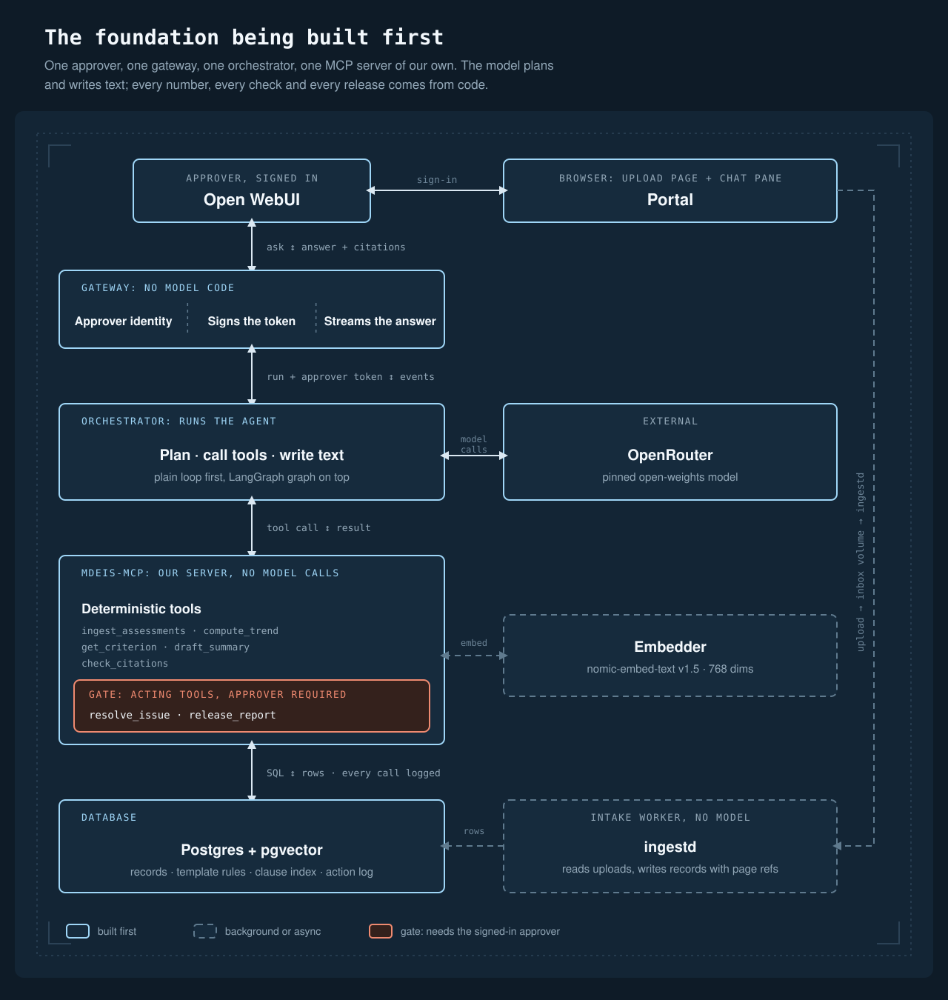

# Lucent AI architecture

Lucent AI measures and explains learning from school records, against a criteria template the school
supplies. It never decides, ranks or recommends for a person. A named human approves everything
that leaves the system.

**Status: built and run on the author's server, with two parts not built.** The two diagrams below
show the foundation and the full design. The second-check model (Jev) and the n8n automation lane
are in the diagram as optional and are **not built**: no code calls Jev, and n8n runs with no
workflow. The README has a table of what is built, what has been run and what is planned; the
results are in `EVALS.md`. This page does not claim a test has passed.

The diagrams are SVG files in [`docs/img/`](docs/img/). Open them on their own to read the small
text at full size.

## 1. The foundation, built first

This is the smallest system that does the whole job end to end. One approver signs in, asks for a
report, and releases it. Nothing else is needed for that.

| Part | What it does | What it never does |
| --- | --- | --- |
| **Open WebUI** (`webui`) | The chat screen. Signs the approver in | Talks to a model or to the data |
| **Portal** (`portal`) | The page a user opens first: upload boxes, a status list, the chat beside it | Parses a file. It saves the file and records a `documents` row |
| **Gateway** (`gateway`) | Looks like an OpenAI endpoint to Open WebUI. Reads who is signed in, signs a short-lived approver token, streams the answer back | Calls a model, calculates anything, or holds a model key |
| **Orchestrator** (`orchestrator`) | Runs the agent: calls the pinned model through OpenRouter, calls tools, asks the approver about open issues. A plain tool-calling loop first, the LangGraph graph on top | Calculates, or reads learner data except through a tool |
| **mdeis-mcp** | Our MCP server. Every calculation, citation check and release. Clause search over pgvector | Calls a model. A reviewer can search the repo and find the model client in one place only |
| **Postgres + pgvector** | Records, parsed template rules, the clause index, the action log | |
| **ingestd** | Reads uploaded documents and writes records with page references | Calls a model. It has no key |
| **Embedder** | Turns text into 768-dimension vectors for the clause index | |
| **OpenRouter** | Serves the pinned open-weights model | |

The orange box is the gate. `resolve_issue` and `release_report` are the only tools that act. Both
read the approver from the signed-in session, never from anything the model wrote, and both
refuse without a valid approver. See [`docs/SPEC.md`](docs/SPEC.md) section 5.

## 2. The full design

The full design adds four things to the foundation. The graph and the borrowed server are built; the second check and the n8n lane are not. None of them can release a report.

- **The LangGraph graph** replaces the plain loop in the orchestrator (`ORCHESTRATOR_MODE=graph`).
  The model still chooses tools and writes the words; the graph decides in code what must not
  depend on it: a request to rank or advise is refused before the model is called, a problem that
  blocks a subject ends the turn with a plain question to the approver, `check_citations` runs
  after every draft (at most two redrafts, then a plain stop), and `release_report` is offered
  only for a draft that passed the check and was shown in an earlier turn. The conversation is the
  state: the question and the "passed the check" line are messages that Open WebUI keeps, so a
  question can be answered in a later turn without a checkpoint. The plain loop stays as the
  fallback (`ORCHESTRATOR_MODE=linear`). The graph has run on the server and the evals use it, so
  set `ORCHESTRATOR_MODE=graph`; the example file still defaults to `linear`. The graph also has a
  step reserved for the second check, which today passes straight through.
- **A borrowed MCP server** (`pg-mcp-ro`): a read-only Postgres server, run with a role that can
  only `SELECT`. It is the borrowed server the challenge asks for.
- **Jev, a second check (planned, not built).** A small decision model, reached through OpenRouter,
  asks yes-or-no questions about each draft sentence (does it treat a result as a verdict on the
  child, rank or compare learners, or suggest a pathway). Its answer can only **add a hold**. It
  cannot approve, cannot replace a deterministic check, and cannot clear one that failed. It
  would ship off by default, then in shadow mode, and hold only after its threshold is set from a
  measured run. Only the off-by-default settings exist today.
- **n8n, for automations that are not the agent (planned, not built).** The container runs, with
  no workflow and no access to learner data. The first workflow planned is an annotated explainer
  for a report that is already released: it would read released-report views, ask a model for
  plain-language notes on terms, and write a draft that passes a deterministic check and then waits
  for a named person to approve it. n8n could not read raw learner records or the action log, and
  could not release anything. See Future improvements in the README.
- **Langfuse (optional)** records traces, tokens and cost per run. The Postgres action log is
  not optional and does not depend on it.

## 3. One request, step by step

1. The approver asks in Open WebUI. The gateway reads who is signed in and signs a short-lived
   approver token.
2. The gateway sends the conversation, the token and a service key to the orchestrator
   (`POST /run`).
3. The orchestrator asks the model what to do next. When the model wants a tool, the orchestrator
   calls it on `mdeis-mcp`. The token goes to `mdeis-mcp` only. Every call carries a run ID.
4. `mdeis-mcp` computes from the records and the template and returns record IDs and clause IDs
   with every finding. Every call is written to the action log, with its inputs, outputs, time
   and approver.
5. The model writes the draft summary from what the tools returned. `check_citations` confirms
   that every number and rule in it came from a tool in the same run.
6. Progress and the answer stream back through the gateway to the approver. The orchestrator
   composes the final text from the tool results: the chart, the report-card files behind it, the
   rules applied in the rulebook's words, and any assumption made.
7. The approver reads it and says so. `release_report` runs only after `check_citations` is `ok`
   and a newer message from the approver. It refuses without a valid approver, or with a stale
   template or methodology pin.

## 4. How documents come in

The upload path has no model in it. The portal (or `make ingest`) saves the file and records a row. `ingestd` claims
the row, parses the report card with word positions from the page (a fixed layout, checked
against the totals printed on the card), parses the school's methodology document into numbered
sections, writes the records with page references, and compares a new methodology with the
previous version. A new or changed methodology stays in `needs_review` until a named person
acknowledges it. Reports are pinned to the template and methodology versions they were drafted
under, so a later change makes an old draft stale instead of silently different. Details:
[`docs/INGEST.md`](docs/INGEST.md).

## 5. What each part is trusted with

| Secret or power | Held by | Not held by |
| --- | --- | --- |
| Approver-signing secret | `gateway` signs; `mdeis-mcp` only checks | Every other container. The gateway is not reachable from the host |
| Model key for the agent | `orchestrator` | `gateway`, `mdeis-mcp`, `ingestd`, `portal` |
| Model key for annotations (reserved, optional) | `n8n`, its own key | The agent path |
| Write access to learner records | `mdeis-mcp` and `ingestd` (role `mdeis_app`) | `orchestrator`, `n8n`, `pg-mcp-ro`. `portal` can only add and read document rows |
| Read of the action log | `mdeis-mcp` | `n8n`, the model |

Three Docker networks separate the browser-facing containers, the agent path and the data. The
data network is internal. Only Open WebUI and the portal are published, and only on the local
address by default. An optional reverse proxy (`make prod-up`, off by default) is the only part
meant to be public: it forwards to Open WebUI and serves one static page. Ports, roles, networks and the start order are in
[`docs/CONTAINERS.md`](docs/CONTAINERS.md).

## 6. What the design guarantees, and what enforces it

| Rule | Enforced by |
| --- | --- |
| Numbers come from deterministic code and SQL only | `mdeis-mcp` has no model client. `check_citations` rejects a draft with a figure no tool returned |
| Rules live in the template, not in code | Scales, weights, thresholds, stage ranges and banned wording are read from `templates/`, each with a clause ID |
| Every finding cites a record and a clause | `check_citations`, run before any release |
| The approver is the signed-in user | The gateway signs the token. `release_report` and `resolve_issue` read it from the session, never from tool arguments |
| No judgement on a child, no ranking, no pathway advice | The template's wording rules and the draft check. Class counts stay locked until a named person unlocks them |
| Every tool call is logged | The Postgres action log, written by `mdeis-mcp` |
| A second-check model can only hold | Planned design rule. No second-check model is built, so nothing yet depends on it |

## 7. Where to read more

- Tool contracts, data model, run flow: [`docs/SPEC.md`](docs/SPEC.md)
- Containers, networks, ports, roles, secrets, start order, what is cut first if time runs
  short: [`docs/CONTAINERS.md`](docs/CONTAINERS.md)
- Why each choice was made: [`docs/DECISIONS.md`](docs/DECISIONS.md)
- The evaluation tests: [`docs/TESTS.md`](docs/TESTS.md)
