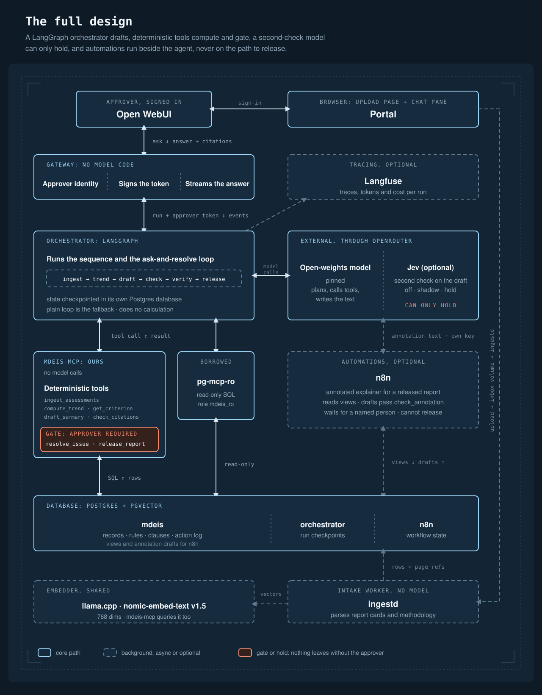

# MDEIS: Multidimensional Educational Intelligence System

Entry for the **African Agentic AI Design Challenge** (Nairobi AI Community and Qhala Trust),
Education track, "The Long View".

MDEIS reads one learner's school records across subjects, terms and years, and reports what the
data shows against a **criteria template the school supplies**. Every finding cites the records
and the template clauses behind it. A **named human approver** must release every report.

> **Status: build in progress (window closes 15 Oct 2026).** This README says what exists and what has
> been run, and nothing more. "Run" means run on the author's server with the output kept; "written"
> means the code and its tests exist but have not been run yet. Results are committed under
> `evals/results/` once they exist.

| Part | Status |
| --- | --- |
| Design, tool contracts, test plan | Written (`docs/`) |
| Criteria templates (a normal and a stricter one) and their loader, database and migrations, the diary, the synthetic practice school and its answer key | Built and run on the author's server |
| The eight tools and the MCP server, with the contract tests that define them | Written, awaiting a server run |
| Report-card and methodology readers, the document worker, version pins | Written, awaiting a server run |
| Orchestrator (a plain tool loop, and the LangGraph agent), the gateway | Written, awaiting a server run |
| Class view (counts only) | Written and **locked**: off, and not listed, unless switched on |
| Public page and reverse proxy | Written, not deployed |
| `make demo` (the one command) | **Planned** until it has passed from a fresh clone on a clean machine |
| Evaluation results | None yet. `EVALS.md` will quote real runs only |

**All data in this repository is synthetic.** There are no real learners, names, photos or
schools.

---

## Problem statement

In many African schools a learner can move up a class without having the basics of the class
below. A learner in Form 3 may still read, write, listen or do arithmetic at a Form 1 level, and
nobody sees it until it is very late. The evidence exists, in marks, assessment types and teacher
notes spread over terms and years, but it is scattered, uses different scales, and is rarely read
as one story.

Existing "AI for schools" tools tend to do one of two harmful things: hand a model a pile of
marks and let it say what it likes (unsourced, unrepeatable), or put a judgement on a child
("weak", "gifted", a rank, a career path). The challenge forbids both, and so do we.

## Solution overview

MDEIS is a small agent system that:

1. **Loads** one learner's assessment records and converts every scale using the school's
   template. Messy data (missing terms, duplicates, marks above the maximum, notes that
   contradict marks) becomes a **typed issue** with a plain question, never a silent fix.
2. **Computes**, with deterministic code only, a trend per skill across terms and the **gap to
   the stage standard**: where the learner's work sits against what the template expects at that
   stage. The comparison is always with the standard, never with classmates.
3. **Drafts** a plain-language report. The model writes words only. Every number comes from a
   tool, and every sentence carries record and clause citations.
4. **Checks** the draft mechanically (`check_citations`) and **holds** it until a named approver
   reads it and releases it.
5. **Logs** every tool call in an append-only action log.

The rules (scales, thresholds, stage ranges, minimum evidence, banned words) live in the
template, not in code. A different school brings a different template, and the code is
unchanged.

## Target users

- **Teachers and school heads** (the approver): see where a learner's foundation skills sit
  against the stage standard, and decide what the report says before it goes anywhere.
- **Parents and guardians** (readers of released reports): get a sourced, plain-words account of
  the data, with the evidence behind each statement.
- **School leaders** (later, locked): counts of learners below, within and above the stage range,
  with no names. This view is built only after the safety tests pass. See Limitations.

## Architecture

Every part is a container, and they talk to each other over private Docker networks. Only the
Open WebUI port and the upload page port are published to your machine, on the local address.



The full picture, the smaller foundation built first, one request step by step and what each part
is trusted with are in [`ARCHITECTURE.md`](ARCHITECTURE.md).

- **The gateway** knows who is signed in, signs the approver token and calls the orchestrator. No calculation and no model code.
- **The orchestrator** (LangGraph) runs the sequence and the ask-and-resolve loop. It does no calculation.
- **n8n** runs automations outside the agent, such as an annotated explainer for a released report. It reads released content through views, writes drafts for review, and cannot release anything.
- **The model** plans, calls tools and writes the summary text. It never produces a number that
  a tool did not return.
- **The MDEIS server** does every calculation, check and release, and makes no model calls.
- **Postgres** holds records, parsed template rules, a pgvector index of clause text, and the
  action log.

Details: [`ARCHITECTURE.md`](ARCHITECTURE.md), [`docs/SPEC.md`](docs/SPEC.md) and [`docs/CONTAINERS.md`](docs/CONTAINERS.md) (containers, networks, ports). Decisions and their reasons: [`docs/DECISIONS.md`](docs/DECISIONS.md).

## Setup/installation instructions

You need a server or computer with Docker (with the Compose plugin), `make`, `python3` and `git`, and
your own OpenRouter key. **No key or secret is ever committed.** Everything runs in containers.

```bash
git clone https://github.com/Sedoid/MDEIS && cd MDEIS
make env-init            # makes .env with random secrets; then edit the lines marked for you
make dev-config          # checks that every variable is set
make dev-up              # downloads the embedding model, builds and starts everything
make demo-data           # loads the rulebook, the methodology and the practice report cards
```

Then open `http://127.0.0.1:3000` and sign in with the administrator account named in `.env`.
`make demo` is meant to do all of this in one command and to check each step; **it is Planned**
and this README will not call it done until it has passed from a fresh clone with only `.env`
edited. `make clean` removes the containers and the data volumes. `make help` lists every command.

The values you provide are the ones `make env-init` marks for you: your OpenRouter key and the
open-weights model name (`OPENROUTER_API_KEY`, `OPENROUTER_MODEL`, and optionally
`OPENROUTER_PROVIDER`), and the administrator's email and password for Open WebUI.
`.env.example` is the source of truth and has a comment for every variable.

For development:

```bash
make test        # unit and acceptance tests, in a container
make test-contract   # only the tool contract tests
make lint        # ruff
make check       # structure check and secret scan
make dev-health  # proves the wiring and the safety properties of the running stack
```

## Usage instructions

**Planned.** The intended walkthrough, which is also the demo script:

1. Sign in to Open WebUI as the approver and ask about a synthetic learner, for example
   "Show me the longitudinal picture for L-0007."
2. If the records have blocking problems (a missing term, a duplicate, a mark above the
   maximum), the agent asks you in chat. You answer; the agent records your answer with
   `resolve_issue`.
3. The agent computes trends and the gap to the stage standard, and drafts a report with
   `[A-000123]` record citations and `[TR-2]` clause citations.
4. `check_citations` runs. If it fails, the draft is fixed and re-checked (bounded retries).
5. You read the draft and approve. Only then does `release_report` run, with your name from the
   session.
6. Ask it to rank two learners. It refuses and explains why.

Swapping `templates/v1.yaml` for `templates/v2-strict.yaml` changes the results for the same
data, with no code change. That is the proof that rules live in the template.

## Technology stack

| Layer | Choice |
| --- | --- |
| Interface | Open WebUI, behind a small FastAPI gateway |
| Orchestration | LangGraph (Python, open source) runs the agent in its own `orchestrator` container, with a plain tool loop as the fallback. n8n (open source) runs automations beside it |
| Optional second check | Jev (`typesafe/jev-1.13`) through OpenRouter. Third-party, not open-weights, off by default. It can only hold a draft |
| Model | A pinned open-weights model through OpenRouter (provider order fixed, fallbacks off, data collection denied). The model slug is pinned in the environment file |
| Our MCP server | Python 3.12 and the official MCP Python SDK, Streamable HTTP |
| Borrowed MCP server | A read-only Postgres MCP server |
| Data | Postgres 16 with pgvector |
| Embeddings | llama.cpp server with an open embedding model |
| Packaging | Docker Compose, one container per part |
| Tracing (optional) | Langfuse |
| Quality | pytest, ruff, GitHub Actions |
| Deployment (bonus) | Docker Compose on a personal server |

## Agent architecture

One agent loop, orchestrated by LangGraph, using tools. It is not a chatbot wrapper: the model cannot
produce a finding except through a tool call, and the gate sits on the only irreversible action.

- **Plan and call:** the model chooses which tools to call and in what order for the request.
- **Ask and resolve:** a blocking data issue stops the affected subject. The agent asks the
  approver, then records the answer. It does not guess.
- **Draft and check:** the model writes the summary text; a deterministic checker accepts or
  rejects it.
- **Gate:** release needs a human approver taken from the signed-in session. The model cannot
  name or change the approver.
- **Refuse:** requests to rank, compare learners, put a judgement on a child or suggest a pathway are refused
  with a reason.

This project is built with the help of AI coding agents (Claude Code). The agent rules and task
plans are kept outside this repository. Every change is reviewed by the author, and the tests and
CI are the check on the code.

## MCP implementation

Our server is written in Python with the official MCP SDK and served over Streamable HTTP, which
Open WebUI supports natively. All tools return structured JSON. A refusal is a normal structured
result with reasons, not an exception. Every call is written to the action log with the run id
and the approver, if any. The approver is read from a verified, short-lived signed token
forwarded as a header, never from a tool argument.

Contracts for every tool: [`docs/SPEC.md`](docs/SPEC.md) section 5. Tool examples for reuse will
be in `TOOLS.md` once the tools exist.

## MCP tools/servers

**Ours (the MDEIS server). Written, awaiting a server run.**

| Tool | Kind | What it does |
| --- | --- | --- |
| `ingest_assessments` | read | Loads one learner's records, converts scales, returns typed issues |
| `resolve_issue` | **acting** | Records the approver's answer to one issue |
| `compute_trend` | read | Deterministic trend and gap to the stage standard, with citations and a `result_hash` |
| `get_criterion` | read | Finds the template clause to cite (pgvector search) |
| `draft_summary` | write | Stores the model's text as a pending report |
| `check_citations` | read | Rejects uncited, unsourced or banned-word text |
| `release_report` | **acting, the gate** | Releases a checked report. Needs a valid approver |
| `stage_gap_counts` | read, **locked** | Counts only, no names, one school, groups below the template's minimum hidden. Written but off: not listed unless switched on by a named person |

**Borrowed.** [crystaldba/postgres-mcp](https://github.com/crystaldba/postgres-mcp) (MIT licence), in
its restricted read-only mode and connected with a database role that can only SELECT, so a write is
refused twice. The model may use four of its lookups (`list_schemas`, `list_objects`,
`get_object_details`, `execute_sql`). Numbers the model gets from it are not findings: the citation
check only accepts numbers that the school's own tools returned.

**Reused open-source software.** Nothing here is hidden: Open WebUI (the interface), Postgres and
pgvector, llama.cpp with the nomic-embed-text-v1.5 embedding model, n8n (automations beside the
agent), LangGraph (the agent graph), the official MCP Python SDK, FastAPI and uvicorn, psycopg,
pydantic, PyYAML, httpx, pdfplumber (reads the report cards), Caddy (the optional public proxy),
and for development pytest, ruff and fpdf2 (draws the practice report cards). The optional Jev
check is a third-party model reached through OpenRouter. It is not open-weights, it is off by
default, and it can only hold a draft. One more tool, `record_verification`, stores its result. It is
not in the model's tool list. The orchestrator calls the model with plain HTTP and the MCP SDK; it
does not use LangChain's model or MCP adapters.

## Human-in-the-loop workflow

Two points need a person, both with the named approver taken from the session:

1. **Resolving data problems.** The system does not repair records. A person answers.
2. **Releasing a report.** `release_report` refuses without a valid approver or if
   `check_citations` has not passed. Both allowed and refused attempts are logged.

Nothing reaches a parent or teacher outside this gate. The approver reads the draft in chat
before anything is released.

## Evaluation

**Planned.** Eleven tests in two layers, described in
[`docs/TESTS.md`](docs/TESTS.md): a deterministic core layer that runs on every push, and an
agent layer that runs five times each and reports the spread. Results will be committed under
`evals/results/` and quoted in `EVALS.md`. Failures are recorded as failures.

## Safety rules

- Numbers come only from deterministic code and SQL.
- Rules come from the template, with a clause ID on each.
- No judgement on a child: findings describe the data ("reading in the Form 1 range for three
  terms"), never "weak" or "gifted". No ranking or comparison between learners.
- No pathway, subject-choice or career suggestions.
- Synthetic data only.
- No secrets in the repo.

## Limitations

- **Mostly not yet run.** See the status table. This README says what works and what was tested,
  and nothing more.
- **Synthetic data only.** Real-world messiness, real handwriting and real school records are
  untested. The template values in `v1` are placeholders until a teacher confirms them.
- **Evidence is limited to records.** Marks and notes show attainment, not why. MDEIS does not
  explain causes and does not decide anything about a learner.
- **Small-model risk.** An open-weights model can write a poor sentence. The citation checker
  catches missing sources and banned words, but not every poor phrasing, which is why a person
  approves.
- **Class view is locked.** The code exists but is off. It is switched on only after the safety
  tests pass and an approver is named. Counts only, no names, a minimum group size from the
  template, one school. A shown group can still point at one child ("below: 1"); that is a known
  weakness.
- **The diary is protected from edits, but not from its own owner.** The action log refuses
  UPDATE, DELETE and TRUNCATE three ways: the tools' database role has no such rights, a trigger
  refuses them, and each line is chained to the one before it, so `verify_action_log()` shows a
  changed line. That role also owns the tables, so it could switch the trigger off, and a full
  rewrite by it would not be detected. A call that is killed in the middle (a crash, a stopped
  container) leaves no line.
- **One school, one language** in the first version.

## Future improvements

- A separate owner role for the database tables, so the tools' role cannot change the diary's
  protections.
- Teacher-confirmed template values from real stage standards, and templates for other
  curricula.
- The locked class view, then school-level gap reporting for leaders.
- Local-language report text, checked by a human.
- Evidence from cases judged by teachers to measure how often the gap findings agree with
  teachers' own judgement.
- Parent-facing report layouts, and charts and PDF downloads served by our own server after
  release.
- Import from common school record formats.

## Repository map

Full detail in [`docs/STRUCTURE.md`](docs/STRUCTURE.md).

```
src/mdeis/      MCP server (tools/) and deterministic core (core/)
templates/      criteria templates
src/orchestrator/   the LangGraph agent service
workflows/      n8n workflow exports (automations)
synthetic/      synthetic data generator    data/synthetic/  its output
tests/ evals/   deterministic tests, agent-layer evals and results
deploy/         service config and scripts
docs/           spec, containers, tests, template, decisions
```

## Licence

Apache License 2.0, an OSI-approved licence. See [`LICENSE`](LICENSE).

## Team

Up to three members, all 18 or over and resident in Africa, as the challenge requires. Names to
be added.
