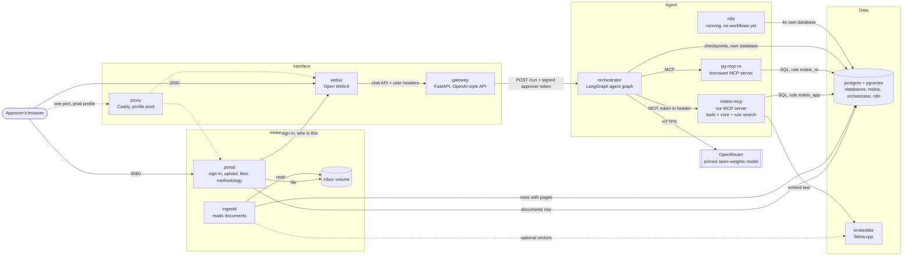
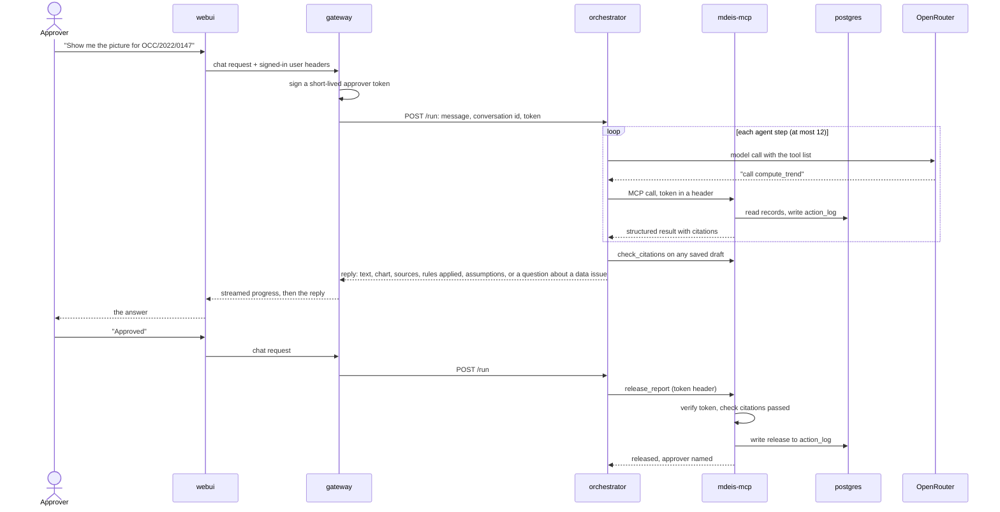

# CONTAINERS: how the system runs

This is the system as built and run on the author's server. Every part runs in its own container.
They talk to each other by service name over private Docker networks. Two ports are published for
a normal start: the chat (`webui`) and the upload page (`portal`). With the `prod` profile a proxy
publishes one front door. Documents come in through `portal` and `ingestd`, described in
[`INGEST.md`](INGEST.md). The commands to start it are in [`STARTUP.md`](STARTUP.md).

## 1. The picture

The styled diagrams are in [`ARCHITECTURE.md`](../ARCHITECTURE.md). The diagram below is the
detailed one, with every container and every connection that exists.



Read it as four layers. The **Interface** layer knows who is signed in. The **Agent** layer
decides which tool to call next. The **Intake** layer takes uploaded documents and turns them
into records, with no model involved. The **Data** layer holds the records. The model never
touches the data layer directly: it asks for a tool, and the tool runs.

`n8n` is up but has no workflow built, so nothing in the agent path depends on it. It is kept
for seasonal automations that are not the agent (see "Future improvements" in the README). Those
would read released reports through a read-only role and could never act.

The second-check model (Jev) is **not built**. The settings for it exist in `.env.example` and
default to `off`, and the agent graph has a pass-through step where it would sit. No container,
tool or call exists for it today.

## 2. The containers

| Container | What it is | Job | Talks to | Port (inside) |
| --- | --- | --- | --- | --- |
| `webui` | Open WebUI, pinned image | The chat screen. Holds the sign-in. Shown as "Lucent AI" | `gateway` | 8080 |
| `gateway` | Our FastAPI service | Looks like an OpenAI endpoint to `webui`. Knows the signed-in user, signs the approver token, calls `orchestrator`, streams the answer and its progress back, strips pictures from the history it sends on. No model code | `orchestrator` | 8000 |
| `orchestrator` | Our Python service: FastAPI and LangGraph | Runs the agent: model calls, tool calls, the ask-and-resolve loop, the citation re-draft loop, and composes the final reply (charts, sources, rules applied, assumptions). Does no calculation. The only container in the agent path with a model key | `mdeis-mcp`, `pg-mcp-ro`, `postgres` (own database), OpenRouter | 8300 |
| `mdeis-mcp` | Our MCP server (Python) | Every calculation, check and release, and the rule search. No model calls | `postgres`, `embedder` | 8100 (`/mcp`) |
| `pg-mcp-ro` | `crystaldba/postgres-mcp`, a borrowed read-only server | The borrowed server the challenge requires. Inspection queries only, as the read-only role | `postgres` | 8200 |
| `portal` | Our FastAPI service (separate from `gateway`) | The page people sign in to: upload by file or folder, files grouped by class and year, the methodology panel, open a file in a new tab, and the chat beside it. Checks the sign-in with `webui`, saves files, records a `documents` row. Parses nothing | `webui`, `postgres` | 8080 |
| `ingestd` | The `mdeis-mcp` image, run as a worker | Claims pending documents, parses them, writes records with page references. No model, no key | `postgres`, `embedder` (optional), the `inbox` volume (read-only) | none |
| `embedder` | llama.cpp server in embedding mode | Turns rule text into vectors for the rule search | none | 8081 |
| `postgres` | `pgvector/pgvector:0.8.7-pg16` | Records, rulebook rules, vectors, the action log, the orchestrator's conversation checkpoints, and n8n's own state | none | 5432 |
| `n8n` | n8n, pinned image | Running with no workflows. No access to learner data | its own database | 5678 |
| `migrate` | The `mdeis-mcp` image, run once | Applies the database migrations, then exits | `postgres` | none |
| `proxy` | Caddy, profile `prod` | One front door for a server. Three files select the mode (section 5) | `webui`, `portal` | 80, 443 |

Two more services exist only behind the `tools` and `test` profiles: `rules` and `admin` (the
commands behind `make load-criteria`, `make ingest`, `make class-data` and similar), and `test`
with `practice-data` (the test run and the practice report cards). They start when a command asks
for them, not with the stack.

Not built: the `tracing` profile (Langfuse). Tracing is an optional setting in `.env`; the
Postgres action log is the audit record either way.

## 3. How one request flows



The agent graph has these steps: `screen` (the question is checked before any model call),
`agent` (one model call), `act` (run the tools it asked for), `ask` (stop and put a data problem
to the person, only when it bears on the question), `check` (run the citation check on a saved
draft), `verify` (a pass-through, kept for a second check that is not built) and `finish`. A
draft that fails the citation check is written again up to two times, then the agent stops and
says so.

Three rules to notice. The model's output never carries the approver: the token travels in a
header set by the gateway, and `mdeis-mcp` verifies it. `release_report` is the only step that
can leave the system, and it refuses without a valid approver. And a second-check model, when it
is built, can only hold a draft, never approve one or clear a failed check.

## 4. Choices that are easy to ask about

| Question | Answer | Why |
| --- | --- | --- |
| How does the chat connect? | `webui` talks to `gateway` as if it were an OpenAI endpoint | Open WebUI accepts any OpenAI-style API. A gateway container lives in the repo and is testable |
| Who calls the model? | The `orchestrator`, nothing else | The gateway holds the approver-signing secret. Model-driven code must not share a process with it. Search the repo for the OpenRouter client and it appears in one place |
| Where does rule search live? | In `mdeis-mcp`, as the `get_criterion` tool | It is a tool, so it belongs behind the MCP server. The gateway stays thin: identity, routing, streaming |
| How many Postgres servers? | One, with the pgvector extension and three databases (`mdeis`, `orchestrator`, `n8n`) and separate roles | The orchestrator's role cannot read learner data |
| Where are conversations kept? | The `orchestrator` database | LangGraph checkpoints each conversation there, so a question to the approver can be answered in a later turn |
| How many MCP servers? | Two: `mdeis-mcp` (ours) and `pg-mcp-ro` (borrowed) | Matches the challenge: our own server plus one borrowed server |
| Why is the upload page not in the gateway? | The gateway holds the approver-signing secret and must stay unreachable from the host. The upload page is browser-facing, so it lives in its own container with a database role that can only add and read document rows | Smaller blast radius |
| Why `mdeis-mcp` and not "decision server"? | MDEIS never decides about a learner | The name matters in the live review |

## 5. Networks and ports

Three Docker networks keep each container able to reach only what it needs.

| Network | Members | Internet access |
| --- | --- | --- |
| `edge` | `webui`, `gateway`, `portal`, `proxy` | none needed |
| `agent` | `gateway`, `orchestrator`, `n8n`, `mdeis-mcp`, `pg-mcp-ro` | `orchestrator` needs OpenRouter |
| `data` (internal) | `postgres`, `mdeis-mcp`, `ingestd`, `portal`, `pg-mcp-ro`, `orchestrator`, `n8n`, `embedder` | none |

Published to the host (everything else is internal only). The address is `HOST_BIND`, which is
`127.0.0.1` by default; the author's server sets it so the pages can be reached by IP.

| Host port | Container | Purpose |
| --- | --- | --- |
| `WEBUI_PORT` (3000) | `webui` | The chat |
| `PORTAL_PORT` (8080) | `portal` | The page people sign in to and upload on |
| `N8N_EDITOR_PORT` (5678) | `n8n` | The n8n editor, only with the dev editor switched on |
| `PROXY_BIND`:80 and :443 | `proxy` | The front door, `prod` profile only. 127.0.0.1 unless set otherwise on purpose |

The proxy has three modes, chosen by `CADDYFILE` in `.env`:

| File | Use |
| --- | --- |
| `Caddyfile` | A domain name with https: the page and the chat |
| `Caddyfile.page` | The static about page only, over plain http |
| `Caddyfile.ip` | A bare IP address: chat at `/`, upload page at `/portal/`, static page at `/mdeis-about/`, one port and one host name so the sign-in cookie reaches both. Plain http only, a demo setting |

Inside the networks, containers use service names, for example `http://orchestrator:8300/run`,
`http://mdeis-mcp:8100/mcp`, `http://embedder:8081`, `postgres:5432`. The gateway only accepts
calls that carry the shared key `GATEWAY_API_KEY` that `webui` is configured with, and is only
reachable from the `edge` network, because it trusts the user headers `webui` forwards. `portal`
shares `edge` but does not hold `GATEWAY_API_KEY`, so it cannot use the gateway.

## 6. Databases and roles

One Postgres server. Init scripts create the databases, roles and the `vector` extension. The
schema inside `mdeis` comes from the migrations in `src/mdeis/db/migrations/` (001 to 005). They
are checksummed: editing a migration that has been applied makes `make migrate` stop.

| Database | Role | What it can do |
| --- | --- | --- |
| `mdeis` | `mdeis_app` | Owns the schema. Can only INSERT and SELECT on `action_log`; a trigger blocks UPDATE and DELETE anyway, and each row carries the hash of the one before it |
| `mdeis` | `mdeis_ro` | SELECT on every table except `action_log`. On `learners` it reads the id, school, school reference, created time and, since migration 005, the display name, so a learner can be found by name. Used by the borrowed MCP server |
| `mdeis` | `portal_app` | INSERT and SELECT on `documents`, SELECT on `document_issues`, and SELECT on three columns of `report_cards` (document, year, stage) so files can be grouped by class and year. Nothing else |
| `orchestrator` | `orchestrator_app` | Owns the checkpoint tables. No access to `mdeis` |
| `n8n` | `n8n_app` | Owns n8n's own tables. No access to `mdeis` |
| `mdeis` | `n8n_auto` | Created and reserved for read-only views of released reports. The views are not built yet, so it can read nothing |

`ingestd` uses `mdeis_app`, the same role as `mdeis-mcp`.

**A cost to know about.** Because `mdeis_ro` can read learner names, a question the model answers
through the borrowed server can put a name in the prompt, and so reach the model provider. The
school chose this so a teacher can ask about a learner by name. The provider is pinned, with
fallbacks off and data collection denied (section 8). The README lists it under Limitations.

## 7. Compose layout and commands

```
docker-compose.yml          networks and volumes only
deploy/compose/             one small file per service, merged with -f
  postgres.yml  embedder.yml  mdeis-mcp.yml  ingestd.yml  pg-mcp-ro.yml  orchestrator.yml
  n8n.yml  n8n.dev.yml  gateway.yml  webui.yml  portal.yml  proxy.yml (profile prod)
  test.yml (profile test)
deploy/caddy/               Caddyfile, Caddyfile.page, Caddyfile.ip
deploy/docker/              one Dockerfile per image we build (mdeis-mcp, gateway, orchestrator, portal)
deploy/postgres/            init scripts and the role checks
```

Per-service files are merged with `-f` so they can share the networks. The Makefile hides this.
Do not run `docker compose` by hand. `make help` lists every command; these are the main ones.

| Command | Does |
| --- | --- |
| `make dev-up` | Build what needs building, start everything, apply migrations. Waits until healthchecks pass |
| `make dev-down` | Stop everything, keep the data |
| `make dev-ps`, `make dev-logs SERVICE=orchestrator`, `make dev-restart SERVICE=gateway` | State, logs, restart |
| `make dev-health` | Check every service from the inside |
| `make dev-psql` | Open `psql` inside the Postgres container |
| `make dev-reset` | Stop and delete the data volumes (asks first) |
| `make migrate` | Apply database migrations (safe to run twice) |
| `make load-criteria` | Validate and load the rulebook templates |
| `make rules-status`, `make search-rules Q="..."` | Show the loaded rulebook; try the rule search |
| `make ingest KIND=results FILE=path AS="Name"` | Process one document from the command line (same code as the worker) |
| `make ingest-dir KIND=results DIR=path AS="Name" [RECURSIVE=1]` | Process every report card in a folder |
| `make card-lines FILE=path` | Show the words of a report card with their positions, to see why a card does not read |
| `make ack DOC=... BY="Name"` | A named person accepts a changed methodology document |
| `make practice-data`, `make class-data` | Generate the practice cards, or load a class of cards |
| `make test`, `make test-contract`, `make lint` | pytest, the contract tests, ruff (inside a container) |
| `make evals [ONLY=E-01]` | Run the agent-layer evals against the model, five runs each, results in `evals/results/` |
| `make ask Q="..."` | Ask the orchestrator one question from the command line |
| `make token`, `make probe-signin`, `make probe-portal`, and the other `probe-*` | Check one link in the chain |
| `make prod-up`, `make prod-down`, `make prod-check` | Start, stop and check the proxy profile |
| `make demo` | The one command: planned until it has passed from a fresh clone |

## 8. Who holds which secret

All values come from `.env`, supplied by the user. A secret is given only to the container that
needs it. The model settings (`OPENROUTER_MODEL`, `OPENROUTER_PROVIDER`) are pinned in `.env`;
`OPENROUTER_ALLOW_FALLBACKS` stays `false` and `OPENROUTER_DATA_COLLECTION` stays `deny`.

| Variable | Held by | Not given to |
| --- | --- | --- |
| `OPENROUTER_*` | `orchestrator` | `gateway`, `mdeis-mcp`, `webui`, `portal`, `postgres`, `n8n` |
| `JEV_*` | `orchestrator` (placeholders, default `off`; nothing reads them yet) | the others |
| `N8N_OPENROUTER_API_KEY` (optional, kept apart so spend can be capped separately) | `n8n` | the others |
| `N8N_DB_PASSWORD`, `N8N_ENCRYPTION_KEY`, `N8N_WEBHOOK_KEY` | `n8n` (and `postgres` init for the password) | the others |
| `APPROVER_TOKEN_SECRET` | `gateway` (signs), `mdeis-mcp` (verifies) | `orchestrator`, `n8n`, `webui`, `portal` |
| `ORCHESTRATOR_API_KEY` | `gateway`, `orchestrator` | everything else |
| `GATEWAY_API_KEY` | `webui`, `gateway` | everything else |
| `POSTGRES_*` admin password | `postgres` init only | all services |
| `MDEIS_APP_PASSWORD` | `mdeis-mcp`, `ingestd`, the migration step, `postgres` init | the others |
| `MDEIS_RO_PASSWORD` | `pg-mcp-ro`, `postgres` init | the others |
| `ORCHESTRATOR_DB_PASSWORD` | `orchestrator`, `postgres` init | the others |
| `PORTAL_DB_PASSWORD` | `portal`, `postgres` init | the others |
| `PORTAL_SESSION_SECRET` (signs the page's CSRF tokens) | `portal` | the others |
| `WEBUI_SECRET_KEY` | `webui` | the others |

`orchestrator` never sees `APPROVER_TOKEN_SECRET`, so it can pass a token along but cannot make
one. `gateway` has no model key, so the code that calls the model never shares a process with the
code that signs the token. Neither `portal` nor `ingestd` receives any model key or the token
secret.

## 9. Start order

`postgres` (healthy), then `migrate`, then `embedder`, `mdeis-mcp`, `ingestd` and `pg-mcp-ro`,
then `orchestrator` and `n8n`, then `gateway`, then `webui`, then `portal` (it needs `webui` for
the sign-in check), then `proxy` when the `prod` profile is on. Each service has a healthcheck
and `depends_on` waits for `service_healthy`. `mdeis-mcp` is healthy only when its database
connection works. `orchestrator` is healthy only when it can reach `mdeis-mcp` and its own
database.

## 10. What has been seen working, and what has not

Seen working on the author's server (the pasted output is in the project log and `EVALS.md`):

| Item | Evidence |
| --- | --- |
| Open WebUI forwards the signed-in user as headers; the gateway reads them | Sign-in and approver name in the action log |
| The orchestrator reaches both MCP servers and sends the approver token on every call | The evals and hand runs |
| Streaming through the gateway | Hand runs |
| `docker compose` merging with `-f` | Every `make dev-up` |
| The portal sign-in, and the hand-off so the chat frame is already signed in | Hand runs |
| `pdfplumber` reading the practice cards and the teacher's made-up cards | 50 of 50 cards read |
| The graph agent against the pinned model | `EVALS.md`, five runs of ten scenarios |

Not yet checked, or checked only in part:

| Item | What is left |
| --- | --- |
| Whether Open WebUI shows the streamed progress as a collapsible "Thinking" block and uses the model's display name | Look at it in the browser |
| The name lookup (migration 005 and the prompt change) | Apply the migration on the server and ask by name |
| The llama.cpp image on both amd64 and arm64 | Only amd64 has been run |
| The borrowed server over a long idle period | Not observed |
| `make demo` from a fresh clone | Not run |

## 11. Not built

- The second-check model (Jev). Placeholders only; the graph step is a pass-through.
- n8n workflows and the read-only views `n8n_auto` was made for.
- The `tracing` profile.
- The class view `stage_gap_counts`. It exists in code and is locked by `CLASS_VIEW_ENABLED=false`.
- Other report-card layouts and scanned cards.

## 12. If time runs short

Cut in this order, and say so in the README:

1. The `proxy` profile and the server deploy. Reach the pages over an SSH tunnel.
2. The chat pane inside the portal (use a link instead, `PORTAL_FRAME_CHAT=false`).
3. `embedder` and vector search: `get_criterion` falls back to text search. `ingestd` skips vectors
   when the embedder is absent.
4. The LangGraph graph: set `ORCHESTRATOR_MODE=linear` for the plain tool-calling loop.
5. The `portal` page: documents then go in with `make ingest`. The worker, the parsers and the
   version pin stay.

Never cut: `postgres`, `mdeis-mcp`, `pg-mcp-ro` (a challenge requirement), `orchestrator`,
`webui`, the approver token, the action log, the report-card parser with its page references, and
the version pin.
