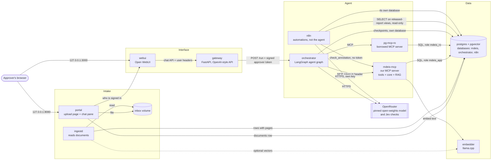
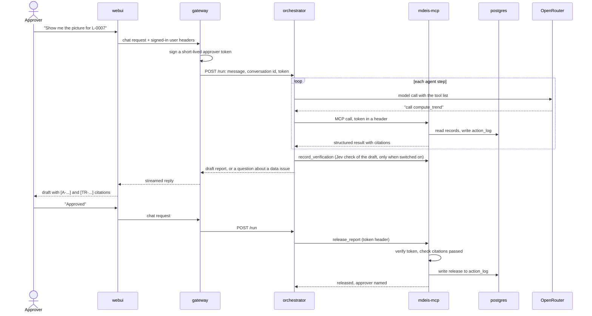

# CONTAINERS: how the system runs

Status: **design v0.** Decisions D-011 to D-017 in `DECISIONS.md` are `proposed` or `open`. The tool
contracts in `SPEC.md` do not change. Devops builds this in the tasks listed at the end. If
something here is wrong, stop and report it under "Needs decision". Do not change it yourself.

Every part runs in its own container. They talk to each other by service name over private
Docker networks. Two ports are published to your machine: the chat (`webui`) and the upload page
(`portal`). Documents come in through `portal` and `ingestd`, described in `docs/INGEST.md`.

## 1. The picture

The styled diagrams are in [`ARCHITECTURE.md`](../ARCHITECTURE.md). The diagram below is the detailed one, with every container and every connection.



Read it as four layers, with `n8n` as a side lane for automations that are not the agent (D-017). The **Interface** layer knows who is signed in. The **Agent** layer
decides which tool to call next. The **Intake** layer takes uploaded documents and turns them into
records, with no model involved. The **Data** layer holds the records. The model never touches the
data layer directly: it asks for a tool, and the tool runs.

## 2. The containers

| Container | What it is | Job | Talks to | Port (inside) | Built in |
| --- | --- | --- | --- | --- | --- |
| `webui` | Open WebUI, pinned image | The chat screen. Signs the approver in | `gateway` | 8080 | T-026 |
| `gateway` | Our FastAPI service | Looks like an OpenAI endpoint to `webui`. Knows the signed-in user, signs the approver token, calls `orchestrator`, streams the answer back, serves report downloads. No model code | `orchestrator`, `mdeis-mcp` (report files) | 8000 | T-029 (code), T-025 (container) |
| `orchestrator` | Our Python service: FastAPI, LangGraph (D-015) | Runs the agent: model calls, tool calls, the ask-and-resolve loop, and the optional Jev checks (D-016). Does no calculation. The only container in the agent path with a model key | `mdeis-mcp`, `pg-mcp-ro`, OpenRouter, `postgres` (own DB only) | 8300 | T-042, T-011, T-044 (code), T-024 (container) |
| `n8n` | n8n, pinned image (D-017) | Automations that are not the agent, for example an annotated explainer of a **released** report. Reads released reports, rules and methodology text through views and returns its draft in the webhook reply. The `orchestrator` calls it with `N8N_WEBHOOK_KEY`. Writes nothing to `mdeis`. Never releases anything | `postgres` (own DB, plus read-only views in `mdeis` through the role `n8n_auto`), `mdeis-mcp` (`check_annotation` only), OpenRouter | 5678 | T-024 (container), T-047 (workflow) |
| `mdeis-mcp` | Our MCP server (Python) | Every calculation, check and release. Also the clause search (`get_criterion`) | `postgres`, `embedder` | 8100 (`/mcp`) | T-023 |
| `pg-mcp-ro` | A borrowed read-only Postgres MCP server | The "borrowed server" the challenge requires. Inspection queries only | `postgres` (read-only role) | 8200 | T-027 |
| `portal` | Our FastAPI service (separate from `gateway`) | The page users open: upload boxes, a status list, and Open WebUI beside it. Checks the sign-in with `webui`, saves files, records a `documents` row. Parses nothing | `webui` (sign-in check), `postgres` (documents only), the `inbox` volume | 8080 | T-036, T-037 (code), T-038 (container) |
| `ingestd` | The `mdeis-mcp` image, run as a worker | Claims pending documents, parses them, writes records with page references. No model, no key | `postgres`, `embedder` (optional), the `inbox` volume (read-only) | none | T-035 (code), T-038 (container) |
| `embedder` | llama.cpp server in embedding mode | Turns text into vectors for the clause index | none | 8081 | T-022 |
| `postgres` | `pgvector/pgvector:pg16` | Records, template rules, clause vectors, the action log, the orchestrator's conversation checkpoints, and n8n's own state | none | 5432 | T-004 |

Optional, behind Compose profiles so a normal start stays light:

| Profile | Containers | Notes |
| --- | --- | --- |
| `tracing` | Langfuse and its own helpers (T-013) | Heavy. Off by default |
| `prod` | A reverse proxy such as Caddy (T-021) | TLS for the server deploy. Not used locally |

## 3. How one request flows



Three rules to notice. The model's output never carries the approver: the token travels in a header
set by the gateway, and `mdeis-mcp` verifies it. `release_report` is the only step that can
leave the system, and it refuses without a valid approver. And the Jev check can only add a hold
on a draft (`verification_hold`); it can never clear a failed deterministic check or stand in for
one (D-016).

## 4. Your sketch against this design

| Your idea | In this design | Why |
| --- | --- | --- |
| `openweb-ui` connects to a gateway | **Yes.** `webui` talks to `gateway` as if it were an OpenAI endpoint | Open WebUI is happy with any OpenAI-style API. A gateway container lives in the repo and is testable. A Pipe function lives inside Open WebUI's own database and is not in git |
| Gateway does LLM generation with OpenRouter | **No.** The `orchestrator` makes the model calls | The gateway holds the approver-signing secret. Model-driven code must not share a process with it (D-015). One agent loop, in one place, is also less to explain. The `orchestrator` has a plain tool-calling mode as the fallback if the graph slips |
| Gateway connects to embedder and pgvector | **No.** `mdeis-mcp` does | The search is a tool (`get_criterion`), so it belongs behind the MCP server. The gateway stays thin: identity, routing, streaming, downloads |
| `embedder`: llama embedder | **Yes**, one container, called only by `mdeis-mcp` | Keeps retrieval local and free of a key. Dimension must match the schema (768 with nomic-embed-text-v1.5). See D-012 |
| `pgvector` container | **One Postgres** with the pgvector extension, three databases (`mdeis`, `orchestrator`, `n8n`) and separate roles | One container to run, but the orchestrator's role cannot read learner data |
| `n8n` connects to Postgres | **Yes: to its own `n8n` database, and to `mdeis` through the narrow role `n8n_auto`** | n8n keeps its workflows and run history in its own database. In `mdeis` it can read four views (released reports, their resolved sources, template clauses, methodology sections). It cannot write to `mdeis`, and it cannot read `assessments`, learner records or the action log, and it cannot touch reports that are not released (D-017). More connections are added later by decision, not by default |
| Orchestrator state | **The `orchestrator` connects to its own `orchestrator` database only** | LangGraph checkpoints each conversation there, so a question to the approver can be answered in a later turn. It reads learner data only through MCP tools |
| `mcp-servers` | Two: `mdeis-mcp` (ours) and `pg-mcp-ro` (borrowed) | Matches the challenge: our own MCP server plus one borrowed server |
| `rag-tool` | **Not a container.** It is the `get_criterion` tool inside `mdeis-mcp` | A separate container adds a network hop and a second thing to explain, for no gain |
| Upload page in the gateway | **A separate `portal` container** | The gateway holds the approver-signing secret and must stay unreachable from the host. The upload page is browser-facing, so it lives in its own container with a database role that can only add document rows |
| `mdeis-decision-server` | Renamed `mdeis-mcp` | MDEIS never decides about a learner. The name matters in the live review |
| That server "uses OpenRouter" | **No model calls from `mdeis-mcp`.** Ever | This is what lets a reviewer prove "numbers come from code only": search the repo for the OpenRouter client and it appears in one place |

The one open point is the optional AI-assisted field mapping in `SPEC.md` 5.1. If it is built, the
call goes through the orchestrator's model client, not from inside `mdeis-mcp`, and the result comes
back as a proposal the approver confirms.

## 5. Networks and ports

Three Docker networks keep each container able to reach only what it needs.

| Network | Members | Internet access |
| --- | --- | --- |
| `edge` | `webui`, `gateway`, `portal` | none needed |
| `agent` | `gateway`, `orchestrator`, `n8n`, `mdeis-mcp`, `pg-mcp-ro` | `orchestrator` and `n8n` need OpenRouter |
| `data` (internal) | `postgres`, `mdeis-mcp`, `ingestd`, `portal`, `pg-mcp-ro`, `orchestrator`, `n8n`, `embedder` | none |

Published to the host (everything else is internal only):

| Host address | Container | Purpose |
| --- | --- | --- |
| `127.0.0.1:3000` | `webui` | The chat |
| `127.0.0.1:8080` | `portal` | The upload page, with the chat beside it. The page a user opens first |
| `127.0.0.1:5678` | `n8n` | n8n editor, **dev profile only** |

Inside the networks, containers use service names, for example `http://orchestrator:8300/run`,
`http://mdeis-mcp:8100/mcp`, `http://embedder:8081`, `postgres:5432`. The gateway only accepts
calls that carry the shared key `GATEWAY_API_KEY` that `webui` is configured with, and is only
reachable from the `edge` network, because it trusts the user headers `webui` forwards. `portal`
shares `edge` but does not hold `GATEWAY_API_KEY`, so it cannot use the gateway.

## 6. Databases and roles

One Postgres server. Init scripts (devops) create the databases, roles and the `vector` extension.
The schema inside `mdeis` comes from T-003's migrations.

| Database | Role | What it can do |
| --- | --- | --- |
| `mdeis` | `mdeis_app` | Owns the schema. Can only INSERT and SELECT on `action_log` (and the trigger blocks UPDATE and DELETE anyway) |
| `mdeis` | `mdeis_ro` | SELECT only, on the tables or views the borrowed MCP server may see |
| `mdeis` | `portal_app` | INSERT and SELECT on `documents`, SELECT on `document_issues`. Nothing else |
| `orchestrator` | `orchestrator_app` | Owns the checkpoint tables. No access to `mdeis` |
| `n8n` | `n8n_app` | Owns n8n's own tables. No access to `mdeis` |
| `mdeis` | `n8n_auto` | SELECT on the views `v_released_reports`, `v_report_sources`, `v_template_clauses`, `v_method_sections`. Read-only, no INSERT anywhere. Nothing else. The role is created by the init script, the grants come with the migration (T-046) |

`ingestd` uses `mdeis_app`, the same role as `mdeis-mcp`.

Note for T-003: the init script creates the `vector` extension as superuser, so the migration
must say `CREATE EXTENSION IF NOT EXISTS vector` and not need superuser rights.

## 7. Compose layout and commands

```
docker-compose.yml          networks, volumes, shared defaults
deploy/compose/             one small file per service, merged with -f
  postgres.yml  embedder.yml  mdeis-mcp.yml  ingestd.yml  pg-mcp-ro.yml
  orchestrator.yml  n8n.yml  gateway.yml  webui.yml  portal.yml
  tracing.yml (profile)   proxy.yml (profile)
deploy/docker/              one Dockerfile per image we build
deploy/postgres/init/       databases, roles, extension
```

Per-service files are merged with `-f` (or `COMPOSE_FILE`) so they can share the networks. The
Makefile hides this. T-004 proves the layout works and may change it if Compose objects.

| Command | Does |
| --- | --- |
| `make dev-up` | Build what needs building and start everything. Waits until healthchecks pass |
| `make dev-down` | Stop everything, keep the data |
| `make dev-ps` | Show state and health |
| `make dev-logs SERVICE=orchestrator` | Follow logs for one service, or all |
| `make dev-restart SERVICE=gateway` | Restart one service |
| `make dev-health` | Check every service from the inside (see T-028) |
| `make dev-psql` | Open `psql` inside the Postgres container |
| `make dev-reset` | Stop and delete the data volumes (asks first) |
| `make ingest KIND=results FILE=path` | Process one document from the command line (same code as the worker) |
| `make load-criteria` | Validate and load the template rules |
| `make ack DOC=D-000012` | A named person accepts a changed methodology document |
| `make demo` | `check-env`, `dev-up`, migrate, load template, ingest the sample methodology and report cards through the same pipeline, smoke test. The one command for a stranger |

## 8. Who holds which secret

All values come from `.env`, supplied by the user. A secret is given only to the container that
needs it.

| Variable | Held by | Not given to |
| --- | --- | --- |
| `OPENROUTER_API_KEY`, `OPENROUTER_MODEL` | `orchestrator` (the same key serves the Jev checks) | `gateway`, `mdeis-mcp`, `webui`, `postgres`, `n8n` |
| `JEV_MODE`, `JEV_MODEL`, `JEV_HOLD_THRESHOLD` (D-016) | `orchestrator` | the others |
| `N8N_OPENROUTER_API_KEY` (may hold the same value as the orchestrator's key, kept apart so spend can be capped separately) | `n8n` | the others |
| `N8N_DB_PASSWORD`, `N8N_AUTO_DB_PASSWORD`, `N8N_ENCRYPTION_KEY` | `n8n` (and `postgres` init for the passwords) | the others |
| `APPROVER_TOKEN_SECRET` | `gateway` (signs), `mdeis-mcp` (verifies) | `orchestrator`, `n8n`, `webui` |
| `ORCHESTRATOR_API_KEY` | `gateway`, `orchestrator` | everything else |
| `GATEWAY_API_KEY` | `webui`, `gateway` | everything else |
| `POSTGRES_*` admin password | `postgres` init only | all services |
| `MDEIS_APP_PASSWORD`, `MDEIS_RO_PASSWORD`, `ORCHESTRATOR_DB_PASSWORD` | the matching service | the others |
| `WEBUI_SECRET_KEY` | `webui` | the others |
| `PORTAL_DB_PASSWORD` | `portal`, `postgres` init | the others |
| `PORTAL_SESSION_SECRET` (signs the page's CSRF tokens) | `portal` | the others |

`MDEIS_APP_PASSWORD` is also given to `ingestd`. Neither `portal` nor `ingestd` receives any model
key or `APPROVER_TOKEN_SECRET`.

`orchestrator` never sees `APPROVER_TOKEN_SECRET`, so it can pass a token along but cannot make one. `n8n` has neither the secret nor a token, so every acting tool refuses its calls. `gateway` has no model key, so the code that calls the model never shares a process with the code that signs.

## 9. Start order

`postgres` (healthy) then `embedder` and `mdeis-mcp` and `ingestd` and `pg-mcp-ro`, then
`orchestrator` and `n8n`, then `gateway`, then `webui`, then `portal` (it needs `webui` for the sign-in check). Each service has a healthcheck, and `depends_on` waits for `service_healthy`.
`mdeis-mcp` is healthy only when its database connection works. `orchestrator` is healthy only when it can reach `mdeis-mcp` and its own database. `n8n` imports the committed workflows from `workflows/` on first start.

## 10. Things we have not verified (check these first)

Each is checked by the task named. If a check fails, the fallback is in the right-hand column.

| Assumption | Checked in | Fallback |
| --- | --- | --- |
| Open WebUI forwards the signed-in user's name and id as headers to an OpenAI-style connection | T-026 | The gateway reads the user from a per-user key or token instead |
| The MCP client (`langchain-mcp-adapters`) can send a custom header on every call, set per run (carries the approver token) | T-024 | Open the MCP session ourselves with `httpx` and the MCP SDK, which accept headers |
| n8n's Postgres node can use the credential for `n8n_auto` and sees only the four views and the annotations table. n8n's MCP client can call `check_annotation` with no approver header | T-024 | Call `check_annotation` with a plain HTTP Request node, or run the check from a make target |
| The orchestrator can stream (SSE) through the gateway to Open WebUI | T-024 | Non-streaming reply with a progress note |
| OpenRouter's Decisions endpoint (`/api/alpha/decisions`, model `typesafe/jev-1.13`) answers `choice` and `noul` questions as the docs describe. It is an alpha path | T-044 | `JEV_MODE=off`. The deterministic checks do not change |
| Open WebUI's background calls (chat titles, tags, follow-up suggestions) hit the gateway and wake the agent | T-026 | Turn those features off in Open WebUI, or have the gateway answer them without the orchestrator |
| The llama.cpp server image runs on both amd64 and arm64 (your Mac is arm64) | T-022 | A small pinned embedding image from another project |
| The chosen borrowed Postgres MCP server speaks Streamable HTTP or SSE, which the MCP client can use | T-027 | Wrap it with a small stdio-to-HTTP bridge, and say so in the README |
| `docker compose` merging with `-f` works as described on the versions we target | T-004 | Adjust the layout |
| The Open WebUI login cookie reaches `portal` (same host, different port) and `portal` can validate it against Open WebUI's API | T-039 | `portal` asks for the Open WebUI login itself and passes it on once, or falls back to named users in `.env` |
| Open WebUI allows being framed by the portal's address and keeps its session inside the frame | T-039 | The chat pane becomes a button that opens Open WebUI in a new tab |
| `pdfplumber` reads the word positions of our generated cards and the real sample card the same way on amd64 and arm64 | T-031 | Read the characters with `pdfminer` directly and group them into lines | |

## 11. If time runs short

Cut in this order, and say so in the README:

0. The n8n annotation workflow (T-047, then T-046). The `n8n` container stays up.
0a. The Jev layer (T-044, T-045). The deterministic `check_citations` stays. Say so in the README.
1. `tracing` profile (Langfuse).
2. `proxy` profile and the server deploy (T-021).
3. The chat pane inside the portal (use a link instead).
4. `embedder` and vector search: `get_criterion` falls back to SQL text search, as in `SPEC.md` 5.4.
   `ingestd` skips vectors when the embedder is absent.
5. The LangGraph graph (T-011): the orchestrator runs the plain tool-calling loop it was built with (T-042).
6. The `portal` page: documents then go in with `make ingest`. The worker, the parsers and the
   version pin stay.

Never cut: `postgres`, `mdeis-mcp`, `pg-mcp-ro` (a challenge requirement), `orchestrator`, `webui`, `n8n` (the container; its workflow can be cut), the
approver token, the action log, the report-card parser with its page references, and the
version pin.

## 12. Tasks

Devops builds the containers. `mcp-engineer` writes the gateway code. The task IDs in the tables
above (T-004, T-022 to T-029, T-035 to T-039, T-042 to T-047) refer to the author's private build plan, which is not part of this
repository.
