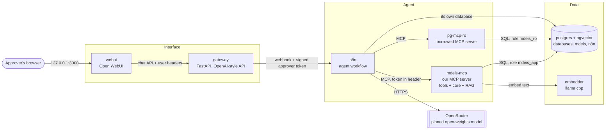
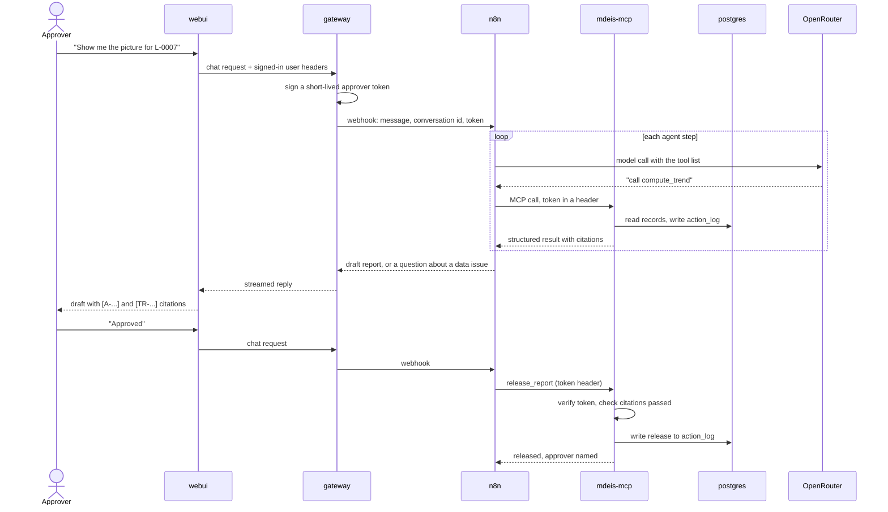

# CONTAINERS: how the system runs

Status: **design v0.** Decisions D-011 and D-012 in `DECISIONS.md` are `proposed`. The tool
contracts in `SPEC.md` do not change. Devops builds this in the tasks listed at the end. If
something here is wrong, stop and report it under "Needs decision". Do not change it yourself.

Every part runs in its own container. They talk to each other by service name over private
Docker networks. Only one port is published to your machine.

## 1. The picture



Read it as three layers. The **Interface** layer knows who is signed in. The **Agent** layer
decides which tool to call next. The **Data** layer holds the records. The model never touches the
data layer directly: it asks for a tool, and the tool runs.

## 2. The containers

| Container | What it is | Job | Talks to | Port (inside) | Built in |
| --- | --- | --- | --- | --- | --- |
| `webui` | Open WebUI, pinned image | The chat screen. Signs the approver in | `gateway` | 8080 | T-026 |
| `gateway` | Our FastAPI service | Looks like an OpenAI endpoint to `webui`. Knows the signed-in user, signs the approver token, calls n8n, streams the answer back, serves report downloads | `n8n`, `mdeis-mcp` (report files) | 8000 | T-029 (code), T-025 (container) |
| `n8n` | n8n, pinned image | Runs the agent: model calls, tool calls, the ask-and-resolve loop. Does no calculation | `mdeis-mcp`, `pg-mcp-ro`, OpenRouter, `postgres` (own DB) | 5678 | T-024 |
| `mdeis-mcp` | Our MCP server (Python) | Every calculation, check and release. Also the clause search (`get_criterion`) | `postgres`, `embedder` | 8100 (`/mcp`) | T-023 |
| `pg-mcp-ro` | A borrowed read-only Postgres MCP server | The "borrowed server" the challenge requires. Inspection queries only | `postgres` (read-only role) | 8200 | T-027 |
| `embedder` | llama.cpp server in embedding mode | Turns text into vectors for the clause index | none | 8081 | T-022 |
| `postgres` | `pgvector/pgvector:pg16` | Records, template rules, clause vectors, the action log, and n8n's own state | none | 5432 | T-004 |

Optional, behind Compose profiles so a normal start stays light:

| Profile | Containers | Notes |
| --- | --- | --- |
| `tracing` | Langfuse and its own helpers (T-013) | Heavy. Off by default |
| `prod` | A reverse proxy such as Caddy (T-021) | TLS for the server deploy. Not used locally |

## 3. How one request flows



Two rules to notice. The model's output never carries the approver: the token travels in a header
set by the gateway, and `mdeis-mcp` verifies it. And `release_report` is the only step that can
leave the system, and it refuses without a valid approver.

## 4. Your sketch against this design

| Your idea | In this design | Why |
| --- | --- | --- |
| `openweb-ui` connects to a gateway | **Yes.** `webui` talks to `gateway` as if it were an OpenAI endpoint | Open WebUI is happy with any OpenAI-style API. A gateway container lives in the repo and is testable. A Pipe function lives inside Open WebUI's own database and is not in git |
| Gateway does LLM generation with OpenRouter | **Not in the normal path.** `n8n` makes the model calls | The challenge needs open-source orchestration. Two agent loops (one in the gateway, one in n8n) would double the code to explain. The gateway keeps the OpenRouter code out of its normal path. A direct mode can be added as the fallback if n8n slips |
| Gateway connects to embedder and pgvector | **No.** `mdeis-mcp` does | The search is a tool (`get_criterion`), so it belongs behind the MCP server. The gateway stays thin: identity, routing, streaming, downloads |
| `embedder`: llama embedder | **Yes**, one container, called only by `mdeis-mcp` | Keeps retrieval local and free of a key. Dimension must match the schema (T-003 placeholder is 384). See D-012 |
| `pgvector` container | **One Postgres** with the pgvector extension, two databases (`mdeis`, `n8n`) and separate roles | One container to run, but n8n's role cannot read learner data |
| `n8n` connects to Postgres | **Yes, to its own `n8n` database only** | n8n keeps its workflows and run history there. It reads learner data only through MCP tools |
| `mcp-servers` | Two: `mdeis-mcp` (ours) and `pg-mcp-ro` (borrowed) | Matches the challenge: our own MCP server plus one borrowed server |
| `rag-tool` | **Not a container.** It is the `get_criterion` tool inside `mdeis-mcp` | A separate container adds a network hop and a second thing to explain, for no gain |
| `mdeis-decision-server` | Renamed `mdeis-mcp` | MDEIS never decides about a learner. The name matters in the live review |
| That server "uses OpenRouter" | **No model calls from `mdeis-mcp`.** Ever | This is what lets a reviewer prove "numbers come from code only": search the repo for the OpenRouter client and it appears in one place |

The one open point is the optional AI-assisted field mapping in `SPEC.md` 5.1. If it is built, the
call goes through the gateway's model client, not from inside `mdeis-mcp`, and the result comes
back as a proposal the approver confirms.

## 5. Networks and ports

Three Docker networks keep each container able to reach only what it needs.

| Network | Members | Internet access |
| --- | --- | --- |
| `edge` | `webui`, `gateway` | `webui` none needed, `gateway` none |
| `agent` | `gateway`, `n8n`, `mdeis-mcp`, `pg-mcp-ro` | `n8n` needs OpenRouter |
| `data` (internal) | `postgres`, `mdeis-mcp`, `pg-mcp-ro`, `n8n`, `embedder` | none |

Published to the host (everything else is internal only):

| Host address | Container | Purpose |
| --- | --- | --- |
| `127.0.0.1:3000` | `webui` | The app. The one port a user needs |
| `127.0.0.1:5678` | `n8n` | n8n editor, **dev profile only** |

Inside the networks, containers use service names, for example `http://n8n:5678/webhook/...`,
`http://mdeis-mcp:8100/mcp`, `http://embedder:8081`, `postgres:5432`. The gateway only accepts
calls that carry the shared key `GATEWAY_API_KEY` that `webui` is configured with, and is only
reachable from the `edge` network, because it trusts the user headers `webui` forwards.

## 6. Databases and roles

One Postgres server. Init scripts (devops) create the databases, roles and the `vector` extension.
The schema inside `mdeis` comes from T-003's migrations.

| Database | Role | What it can do |
| --- | --- | --- |
| `mdeis` | `mdeis_app` | Owns the schema. Can only INSERT and SELECT on `action_log` (and the trigger blocks UPDATE and DELETE anyway) |
| `mdeis` | `mdeis_ro` | SELECT only, on the tables or views the borrowed MCP server may see |
| `n8n` | `n8n_app` | Owns n8n's own tables. No access to `mdeis` |

Note for T-003: the init script creates the `vector` extension as superuser, so the migration
must say `CREATE EXTENSION IF NOT EXISTS vector` and not need superuser rights.

## 7. Compose layout and commands

```
docker-compose.yml          networks, volumes, shared defaults
deploy/compose/             one small file per service, merged with -f
  postgres.yml  embedder.yml  mdeis-mcp.yml  pg-mcp-ro.yml
  n8n.yml  gateway.yml  webui.yml
  tracing.yml (profile)   proxy.yml (profile)
deploy/docker/              one Dockerfile per image we build
deploy/postgres/init/       databases, roles, extension
```

Per-service files are merged with `-f` (or `COMPOSE_FILE`) so they can share the networks. The
Makefile hides this. T-004 proves the layout works and may change it if Compose objects.

| Command | Does |
| --- | --- |
| `make dev-up` | Build what needs building and start everything. Waits until healthchecks pass |
| `make dev-down` | Stop everything, keep the data |
| `make dev-ps` | Show state and health |
| `make dev-logs SERVICE=n8n` | Follow logs for one service, or all |
| `make dev-restart SERVICE=gateway` | Restart one service |
| `make dev-health` | Check every service from the inside (see T-028) |
| `make dev-psql` | Open `psql` inside the Postgres container |
| `make dev-reset` | Stop and delete the data volumes (asks first) |
| `make demo` | `check-env`, `dev-up`, migrate, load template and data, smoke test. The one command for a stranger |

## 8. Who holds which secret

All values come from `.env`, supplied by the user. A secret is given only to the container that
needs it.

| Variable | Held by | Not given to |
| --- | --- | --- |
| `OPENROUTER_API_KEY`, `OPENROUTER_MODEL` | `n8n` (and `gateway` only if direct mode is built) | `mdeis-mcp`, `webui`, `postgres` |
| `APPROVER_TOKEN_SECRET` | `gateway` (signs), `mdeis-mcp` (verifies) | `n8n`, `webui` |
| `GATEWAY_API_KEY` | `webui`, `gateway` | everything else |
| `POSTGRES_*` admin password | `postgres` init only | all services |
| `MDEIS_APP_PASSWORD`, `MDEIS_RO_PASSWORD`, `N8N_DB_PASSWORD` | the matching service | the others |
| `N8N_ENCRYPTION_KEY` | `n8n` | the others |
| `WEBUI_SECRET_KEY` | `webui` | the others |

`n8n` never sees `APPROVER_TOKEN_SECRET`, so it can pass a token along but cannot make one.

## 9. Start order

`postgres` (healthy) then `embedder` and `n8n` and `mdeis-mcp` and `pg-mcp-ro`, then `gateway`,
then `webui`. Each service has a healthcheck, and `depends_on` waits for `service_healthy`.
`mdeis-mcp` is healthy only when its database connection works. `n8n` imports the committed
workflow from `workflows/` on first start.

## 10. Things we have not verified (check these first)

Each is checked by the task named. If a check fails, the fallback is in the right-hand column.

| Assumption | Checked in | Fallback |
| --- | --- | --- |
| Open WebUI forwards the signed-in user's name and id as headers to an OpenAI-style connection | T-026 | The gateway reads the user from a per-user key or token instead |
| n8n's MCP client can send a custom header on every call (carries the approver token) | T-024 | Put the token in the MCP URL path, if n8n lets the URL be set per run |
| n8n's agent can stream, or at least return, a response the gateway can pass on | T-024 | Non-streaming reply with a progress note |
| Open WebUI's background calls (chat titles, tags, follow-up suggestions) hit the gateway and wake the agent | T-026 | Turn those features off in Open WebUI, or have the gateway answer them without n8n |
| The llama.cpp server image runs on both amd64 and arm64 (your Mac is arm64) | T-022 | A small pinned embedding image from another project |
| The chosen borrowed Postgres MCP server speaks Streamable HTTP or SSE, which n8n can use | T-027 | Wrap it with a small stdio-to-HTTP bridge, and say so in the README |
| `docker compose` merging with `-f` works as described on the versions we target | T-004 | Adjust the layout |

## 11. If time runs short

Cut in this order, and say so in the README:

1. `tracing` profile (Langfuse).
2. `proxy` profile and the server deploy (T-021).
3. `embedder` and vector search: `get_criterion` falls back to SQL text search, as in `SPEC.md` 5.4.
4. The gateway's direct mode, if it was built.

Never cut: `postgres`, `mdeis-mcp`, `pg-mcp-ro` (a challenge requirement), `n8n`, `webui`, the
approver token, the action log.

## 12. Tasks

Devops builds the containers. `mcp-engineer` writes the gateway code. The task IDs in the tables
above (T-004, T-022 to T-029) refer to the author's private build plan, which is not part of this
repository.
