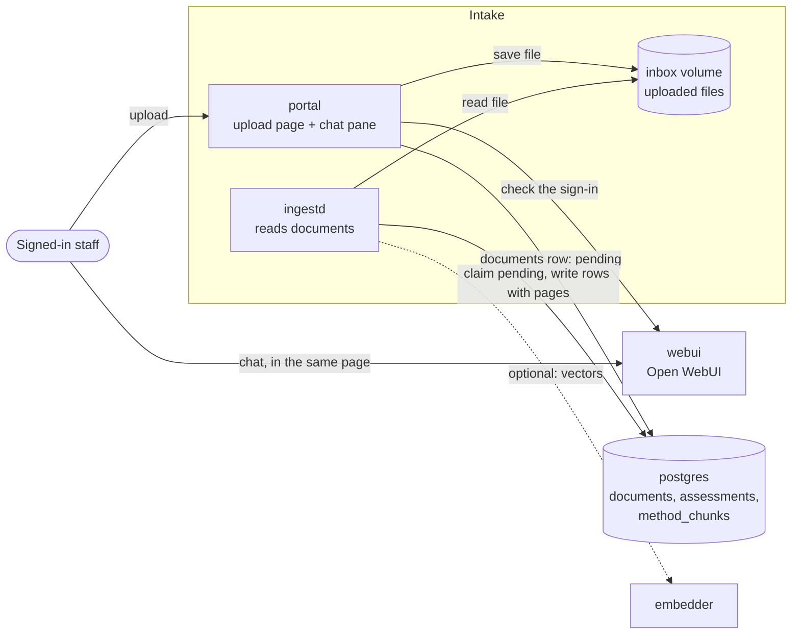

# INGEST: documents in, records out

Status: **design v0.** Decisions D-013 and D-014 in `DECISIONS.md` are `proposed` or `open`. The
agent tools in `SPEC.md` keep their contracts, with the small additions listed in `SPEC.md` 5.5 to
5.7. If something here is wrong, stop and report it under "Needs decision". Do not change it
yourself.

MDEIS gets its two inputs as documents: the **methodology** (MDEIS's evaluation framework, a
numbered document) and **report cards** (a learner's term scores for one school year). A signed-in member of staff
uploads them in the portal. A background worker reads them and writes rows to Postgres. **No
model reads these files.** The parser is ordinary code, so the same file always gives the same
rows, and every row knows the page it came from.

## 1. The pieces

- **`portal`** is the page users open. Left side: upload and a status list. Right side: Open WebUI
  in a frame (or a link, if framing is blocked, see section 7). It saves the file and records a
  `documents` row with status `pending`. It does not parse anything.
- **`ingestd`** is the worker. It claims `pending` rows, parses them and writes the result. It
  uses the same code as `make ingest FILE=...` and as the tools.
- The agent never touches the inbox. It reads records only through the MCP tools.

## 2. Document kinds and status

| Kind | File types | What becomes of it |
| --- | --- | --- |
| `results` | PDF report card in the layout of section 3 (one learner, one school year) | Term scores in `assessments`, one row per subject and term, each with document, page and row. The printed annual values are kept for cross-checking |
| `methodology` | PDF with a text layer, or Markdown | Numbered sections in `method_chunks`, each with page, compared with the previous version and with the sections the template cites |

Status of a document: `pending` then `processing` then `done`, `needs_review` or `failed`.
A methodology document that is `done` or `acknowledged` becomes the **active** one. A `needs_review`
document is **not active** until a named person acknowledges it (`make ack DOC=D-000012`). Until
then the previous methodology stays active, so nothing changes under a report in progress.

Failures are typed (`failure_kind`) and stored with the page or row where they happened:
`not_a_pdf`, `no_text_layer`, `too_large`, `too_many_pages`, `layout_unrecognised`,
`learner_ref_missing`, `year_mismatch`, `no_subject_rows`, `row_unreadable`, `parse_timeout`,
`unsupported_type`. A failed document
stores **no** rows. A partial report card would make a trend look complete when it is not.

## 3. The report card (layout OCC-1)

This is the contract for the parser and for the synthetic cards. It is taken from the school's real
sample (`data/synthetic/samples/amara_nfor_form1_2022-2023.pdf`, synthetic data) and the format
is kept fixed. A different layout means a different parser behind the same interface.

What a card contains, top to bottom:

- School name, then a title line `ANNUAL REPORT CARD · FORM <n> · ACADEMIC YEAR <yyyy>/<yyyy>`.
- Header fields: `Name`, `Date of birth`, `Gender`, `ID number` (the school's learner reference,
  for example `OCC/2022/0147`), `Class`, `Academic year`.
- A table with the columns `Subject`, `Coef. (C)`, `Term 1`, `Term 2`, `Term 3`,
  `Annual score /20`, `Annual score x C`, `Grade`, `Teacher's remarks`. Subject names and
  remarks wrap over several lines, and a row can continue on the next page.
- `TOTAL` (sum of coefficients and of the weighted scores), the `ANNUAL AVERAGE` sentence
  (weighted total divided by coefficients, a value out of 20, and a grade), the `GRADING SCALE`
  text, a conduct paragraph, and `Absences: <n> | Class council decision: <text>`.

How the parser reads it (no model):

1. A **subject row** is found by its numbers: a whole-number coefficient followed by five
   decimals on one line (three term scores, the annual score, the weighted score). The subject
   name is the text to the left of those numbers, including wrapped lines above or below. Read
   the words by position with `pdfplumber`, not as a table: table detection on this layout is
   unreliable (rows split across pages).
2. Each subject gives three **term score** records (Term 1, 2, 3), stored exactly as printed
   (`raw_score`, for example `17.00`) with the denominator 20, the coefficient, the academic year,
   the stage and the subject. A blank, `-` or `ABS` term is stored as missing; it is **not** zero.
3. Remarks are stored as free text against the subject, for display and for the note-conflict
   check. A fragment that continues on the next page is attached to the previous row.
4. The printed annual score, weighted score, grade, totals, average, absences and class council
   decision are stored on the card (`report_cards`, `card_subjects`). The parser **does not**
   recompute or correct them. `ingest_assessments` compares them with the recomputed values and
   returns mismatches as issues for the approver (`SPEC.md` 5.1).
5. The learner is identified by `ID number`. The parser creates the learner on first sight
   (internal ID `L-xxxx`, the school reference and the name). **Date of birth and gender are read
   to confirm the card is whole but are not stored.**
6. Anything it cannot read fails the whole card with the page and row: no title line, no
   subject rows, a row that is not a coefficient plus five numbers, a missing `ID number`, or a
   title year that differs from the `Academic year` field.

Same file (same SHA-256) uploaded twice is marked a duplicate of the first and adds nothing. A
different card for the same learner and year is stored, and shows up as a `duplicate_card` issue
for the approver. Nothing is removed silently.

## 4. Methodology documents

The methodology is MDEIS's own evaluation framework: purpose, principles, the nine-step process,
longitudinal and cross-sectional analysis, trend labels, safeguards, human review. It says what
must be configured but holds no school thresholds. Those live in the template (the school's
configuration). The sample is `data/synthetic/samples/Methodology_of_mdeis.pdf` (version 2.0).

1. Extract text per page (Markdown: one "page", sections by heading).
2. Find section markers at the start of a line, using the document's own numbering:
   - a top-level heading `n.` followed by a title, accepted only if `n` is the next number in
     sequence (this stops numbered list items from being read as sections): `M-4`;
   - a sub-section `n.m` followed by a title: `M-6.4`;
   - a step `Step n:` inside section 4: `M-4.S3`;
   - a lettered measure `A.` to `F.` inside a sub-section: `M-6.3.B`.
   Text before section 1 is kept as an unnumbered title block.
3. Store each section as a `method_chunks` row: ID, title, first page, text, and a hash of the
   normalised text. Tables and lists belong to their section.
4. Compare, and record the result as `document_issues`:
   - against the **previous methodology document**: sections `added`, `removed`, `changed`;
   - against the **template**: each rule may name the section it implements (`method_ref`, for
     example TR-1 implements `6.4`). Report `template_ref_missing` (the section is not in the
     document) and `referenced_section_changed` (a changed or removed section that a template
     rule implements, naming the rule).
5. First document and no mismatches: `done` (active). Any difference: `needs_review`. A review
   therefore says exactly what moved and which of the school's rules rest on it.

**Rules do not come from prose.** Thresholds, scales, grade bands, coefficients and stage ranges
live in the reviewed template (`TEMPLATE.md`). A methodology change that should change a rule is a
human edit to the template file, then `make load-criteria`. The system's job is to notice the
change, say what moved and which rules depend on it, and keep the old version in force until a
person looks.

## 5. Versions and pins

- `compute_trend` results carry the `template_version` and the `methodology_document_id` that
  were active. `result_hash` covers the inputs and the template version only.
- `draft_summary` stores that pin on the report.
- `check_citations` resolves each `[A-...]` to document, page and row, each `[XX-n]` (a template
  rule) to the template version, and each `[M-6.4]` (a methodology section) to the methodology
  document and page. It fails if a cited record does not exist, or a cited rule or section is
  not in the report's pinned template or methodology.
- `release_report` refuses with `stale_pin` if the active template or methodology changed since
  the draft. The approver asks for a new draft. Every refusal is logged.
- A released report is never recomputed under a newer version.

## 6. Who may upload

Identity comes from Open WebUI, so there is one set of accounts.

| Action | Who |
| --- | --- |
| Upload a report card | Any signed-in Open WebUI user |
| Upload a methodology document | Open WebUI role `admin` |
| Acknowledge a methodology change | A named person, from the command line (`make ack`), logged |

The uploader's id and name are stored on the `documents` row and in the action log. They are not
the approver token: releasing a report still needs the gateway-signed approver token (`SPEC.md` 3).
Parent self-upload stays out of scope: this page is for staff.

## 7. The upload page and the chat pane

One page (`portal`), plain HTML and a small script, no external requests. It shows the signed-in
user, two upload boxes (the methodology box only for admins), a status list that refreshes while
anything is `pending` or `processing`, and the chat pane.

- **Sign-in.** The browser already holds an Open WebUI login cookie for this host. The portal
  asks `webui` who that is. If nobody is signed in, the page links to the Open WebUI login.
- **Chat pane.** An `<iframe>` of Open WebUI. It works only if Open WebUI allows being framed by
  the portal's address and keeps its session inside the frame. If the check in the framing spike
  fails, the pane becomes a button that opens Open WebUI in a new tab. The upload flow does not
  depend on it.
- **Safety.** Size and type limits, the file saved under its own ID (the original name is only
  displayed, escaped), a CSRF token on every upload, a strict content security policy, and a
  banner: synthetic data only.
- **No model.** The portal and `ingestd` contain no model client and no key.

## 8. Limitations to state in the README

- Text-layer PDFs in one fixed card layout only (OCC-1). Scanned cards fail with `no_text_layer`.
  OCR and other layouts are future work.
- Records are term scores per subject out of 20. There are no item-level results, assessment
  dates or assessment types, so the methodology's topic-level progress (6.3 E) is not available
  and must be reported as such.
- Scores from different school years are on different curricula. Comparisons across years use the
  school's own grade scale and are labelled as such (methodology 6.5).
- Methodology section detection needs the document's numbering. A free-form document gets one
  unnumbered block and a review flag.
- No supersede or delete of a stored card in v1. A corrected card is a new document, and the
  overlap is settled through `duplicate_card` issues.
- Anyone signed in to Open WebUI can upload report cards. Finer roles are future work.
